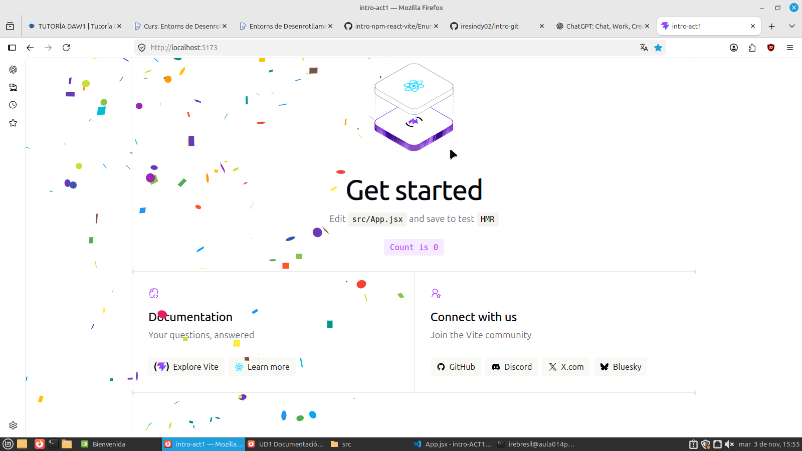
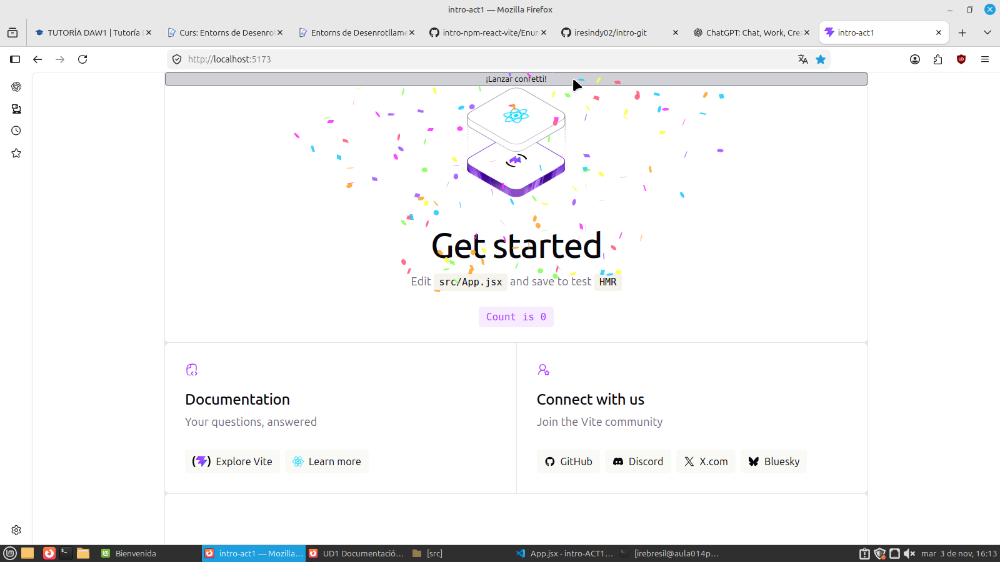
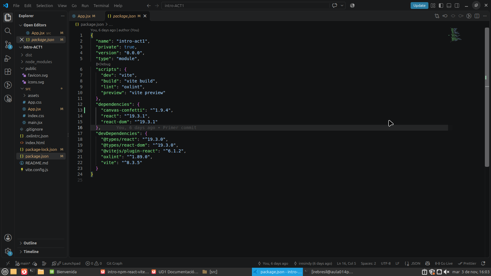
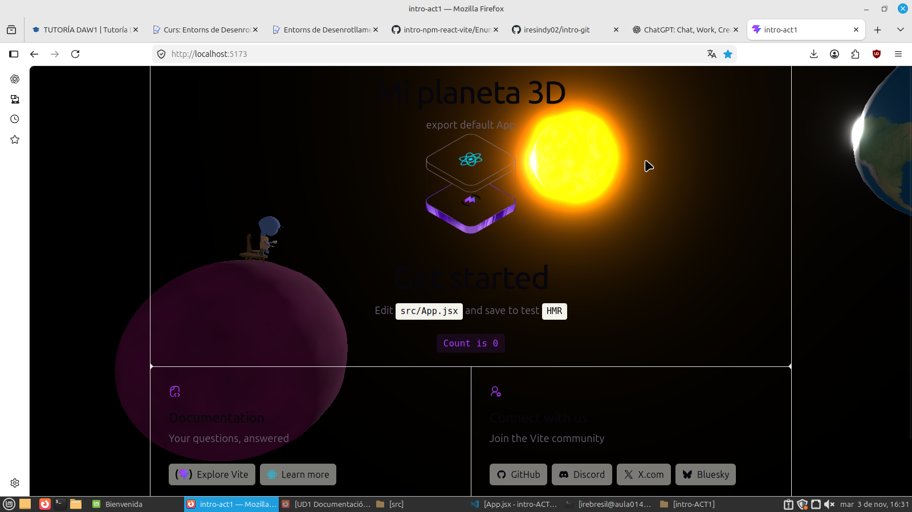

# React + Vite

## 1. Inicia el sitio

Iniciamos con un npm install que nos da las dependencias necesarias. Despues, pondremos el comando npm run dev pra visualizar el sitio web en local.
## 2. Edita el archivo .gitignore

En el .gitignore modificamos pra aclarar porque dos carpetas distintivas estas ndentro de gitignore y cuales son sus riegos.

## 3. Inicia el repositorio y haz un primer commit

Iniciamos el repositorio con git init y hacemos el primer commit.

### 4. Añade un componente en una nueva branch

Ponemos la primera dependencia react-confetti y creamos una rama nueva en la cual hacemos el commit. 

La web:

### 5. Vuelve al estado en el que se quedó la rama main. Desde aquí, tienes que añadir otro componente.

Añadimos una nueva dependencia y un botón que la activa. Además creamos una nueva rama donde hacemos un commmit.

 

Mostramos como se ve package.json:

### 6. De nuevo, vuelve a la rama main y añade un tercer componente.

Añadimos los archivos lanetScene.jsx y .glb cada una metida donde corresponde. Añadimos la depemdenencia requerida. Por último, creamos una neuva rama donde hacmos el commit.

De manera opcional, ponemos el modo oscuro.

### 7. Elige uno de los dos confettis. Haz merge a la rama principal

Elegimos una de las dos dependendencias de confetti y elegimos la accionada con un botón. Entonces borramos la dependencia contraria a la que escogimos y la borramos con npm remove <nombre>.

Por último, se hace un merge con la rama que contiene la dependencia elegida.

### 8. Haz merge de la escena 3D a la rama principal.

Hacemos un merge con la rama que contiene  la escena ED y se arreglan los errores.

Si la carpeta node_modules/ está excluida, ¿borrar una dependencia hace alguna acción sobre el repositorio? ¿Cuál?
Sí, aunque la carpeta node_modules esté excluida del repositorio mediante gitignore, al eliminar una dependencia  se modifican los archivos package.json y package-lock.json

#### Link a la web desplegada en internet